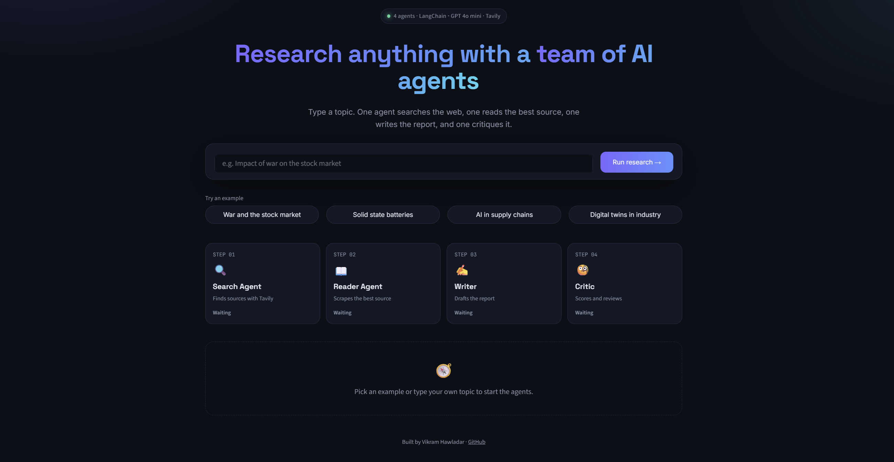

# 🔎 Multi Agent Research System

An AI research assistant where specialised agents work together like a small research team. Give it any topic and it searches the web, reads the most relevant source, writes a structured report and then critiques its own output.

Built with **LangChain**, **LangGraph**, **OpenAI**, **Tavily** and **Streamlit**.

## How it works

```
Topic ──► Search Agent ──► Reader Agent ──► Writer Chain ──► Critic Chain ──► Report + Feedback
          (Tavily)         (BeautifulSoup)   (GPT 4o mini)    (GPT 4o mini)
```

| Step | Component | What it does |
|------|-----------|--------------|
| 1 | **Search Agent** | Tool calling agent that queries the web through Tavily and returns titles, URLs and snippets |
| 2 | **Reader Agent** | Picks the most relevant URL from the search results and scrapes it for deeper content |
| 3 | **Writer Chain** | Combines search results and scraped content into a report with introduction, key findings, conclusion and sources |
| 4 | **Critic Chain** | Reviews the report, gives a score out of 10, lists strengths and areas to improve |

## Tech stack

| Purpose | Tools |
|---------|-------|
| LLM | OpenAI GPT 4o mini via `langchain-openai` |
| Agents and orchestration | LangChain, LangGraph |
| Web search | Tavily |
| Web scraping | Requests, BeautifulSoup |
| Interface | Streamlit |

## Project structure

```
multi-agent-research-system/
├── agents.py          # Search agent, reader agent, writer chain, critic chain
├── tools.py           # web_search (Tavily) and scrape_url (BeautifulSoup) tools
├── pipeline.py        # Command line version of the pipeline
├── app.py             # Streamlit web interface
├── requirements.txt
└── .gitignore
```

## Getting started

**1. Clone the repo**

```bash
git clone https://github.com/VIPRAX17/multi-agent-research-system.git
cd multi-agent-research-system
```

**2. Create a virtual environment and install dependencies**

```bash
python -m venv .venv
source .venv/bin/activate        # Windows: .venv\Scripts\activate
pip install -r requirements.txt
```

**3. Add your API keys**

Create a `.env` file in the project root:

```
OPENAI_API_KEY=your_openai_key
TAVILY_API_KEY=your_tavily_key
```

You can get a free Tavily key at [tavily.com](https://tavily.com) and an OpenAI key at [platform.openai.com](https://platform.openai.com).

**4. Run it**

Web interface:

```bash
streamlit run app.py
```

Command line:

```bash
python pipeline.py
```

## Example output

The Streamlit app shows four tabs after each run:

| Tab | Content |
|-----|---------|
| 📄 Report | The final research report, downloadable as Markdown |
| 🧐 Critic Feedback | Score, strengths, areas to improve and a one line verdict |
| 🔍 Search Results | Raw results from the search agent |
| 📰 Scraped Content | Text extracted by the reader agent |



## Roadmap

1. Feedback loop: send the critic's feedback back to the writer so the report improves itself
2. Let the reader agent scrape several sources instead of one
3. Add memory so follow up questions can build on earlier research
4. Deploy on Streamlit Community Cloud with a "bring your own API key" option

## Author

**Vikram Hawladar**
MSc Digital Engineering, Bauhaus-Universität Weimar
